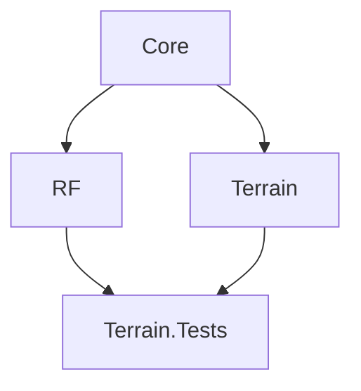

# Architecture

## 1. Overview

**RadioLinkPlannervfV** is a radio link planning project focused on radio-frequency calculations, terrain processing, and shared engineering domain models.

This repository contains a selected public source release of the project. It includes the following components:

- **Core** — Shared domain models and contracts
- **RF** — Radio-frequency calculation implementations
- **Terrain** — Terrain data processing and analysis
- **Terrain.Tests** — Automated tests for the published engineering components

> **Repository scope:** This repository is not the complete RadioLinkPlannervfV application.

## 2. Technology Stack

| Component | Technology |
|---|---|
| Framework | .NET 8 |
| Language | C# |
| Test framework | xUnit |
| Test SDK | Microsoft.NET.Test.Sdk |
| Code coverage | coverlet.collector |

The inspected project files target `net8.0` and enable nullable reference types and implicit usings.

## 3. Repository Structure

The published repository is organized into the following projects:

```text
RadioLinkPlanner-Engineering/
│
├── src/
│   │
│   ├── RadioLinkPlannervfV.Core/
│   │   ├── Enums/
│   │   ├── Interfaces/
│   │   ├── Models/
│   │   ├── Services/
│   │   └── ValueObjects/
│   │
│   ├── RadioLinkPlannervfV.RF/
│   │   └── Calculators/
│   │
│   └── RadioLinkPlannervfV.Terrain/
│       ├── Calculators/
│       ├── Exceptions/
│       ├── Generators/
│       ├── Models/
│       ├── Optimizers/
│       ├── Providers/
│       ├── Readers/
│       └── Services/
│
└── tests/
    └── RadioLinkPlannervfV.Terrain.Tests/
```

### Published Source File Count

| Project | C# Files |
|---|---:|
| Core | 49 |
| RF | 2 |
| Terrain | 18 |
| **Total** | **69** |

The count includes C# source files under `src`, excluding test files and other file types.

## 4. Project Responsibilities

### 4.1 Core

`RadioLinkPlannervfV.Core` contains shared domain abstractions and models.

Its responsibilities include:

- Geographic coordinates and distance-related value objects
- Sites and radio links
- Radio and propagation parameters
- Terrain elevation and profile models
- Link analysis results
- Link budget models
- Multi-site and network analysis models
- Project and report repository contracts

Core has no project references in the published project file.

### 4.2 RF

`RadioLinkPlannervfV.RF` contains radio-frequency calculation implementations.

The published source includes:

| Component | Responsibility |
|---|---|
| `FresnelCalculator` | Fresnel zone calculations |
| `LinkBudgetCalculator` | Radio link budget calculations |

RF references Core.

### 4.3 Terrain

`RadioLinkPlannervfV.Terrain` contains terrain-related processing and analysis components.

Its published components include:

- Great-circle interpolation
- Haversine distance calculation
- Terrain profile generation
- SRTM coordinate mapping
- SRTM DEM reading
- SRTM tile metadata handling
- Offline terrain elevation provider
- Open-Meteo terrain elevation provider
- Fallback terrain elevation provider
- Earth curvature calculation
- Link analysis
- Multi-site evaluation
- Antenna height optimization

Terrain references Core.

### 4.4 Terrain.Tests

`RadioLinkPlannervfV.Terrain.Tests` contains automated tests for the published engineering components.

The test project references:

- Core
- RF
- Terrain

Its test coverage includes terrain providers, SRTM processing, terrain profiles, calculations, optimization, and multi-site evaluation.

## 5. Dependency Architecture

The published project references establish the following dependency structure:



### Project Reference Matrix

| Project | Core | RF | Terrain |
|---|:---:|:---:|:---:|
| Core | — | — | — |
| RF | Yes | — | — |
| Terrain | Yes | — | — |
| Terrain.Tests | Yes | Yes | Yes |

### Dependency Rules

The published project structure establishes these boundaries:

1. Core does not reference RF or Terrain.
2. RF depends on Core.
3. Terrain depends on Core.
4. Terrain.Tests references the engineering projects it tests.

These rules preserve a clear separation between shared domain abstractions and specialized implementations.

## 6. Terrain Data Architecture

The Terrain project includes components for offline and online terrain elevation access.

### Published Providers

| Component | Purpose |
|---|---|
| `OfflineTerrainProvider` | Offline terrain elevation access |
| `OpenMeteoTerrainElevationProvider` | Online terrain elevation access |
| `FallbackTerrainElevationProvider` | Fallback terrain provider |

### SRTM Processing Components

| Component | Purpose |
|---|---|
| `SrtmDemReader` | SRTM DEM reading |
| `SrtmElevationSampleReader` | Elevation sample reading |
| `SrtmCoordinateMapper` | Coordinate mapping |
| `SrtmFileNameResolver` | SRTM tile filename resolution |
| `SrtmTileMetadata` | Tile metadata |

The presence of these components does not imply guaranteed dataset availability or coverage. Actual behavior depends on implementation and configuration.

## 7. Build and Test

Run commands from the repository root.

### Restore dependencies

```bash
dotnet restore
```

### Build

```bash
dotnet build tests/RadioLinkPlannervfV.Terrain.Tests/RadioLinkPlannervfV.Terrain.Tests.csproj --no-restore
```

### Run tests

```bash
dotnet test tests/RadioLinkPlannervfV.Terrain.Tests/RadioLinkPlannervfV.Terrain.Tests.csproj --no-build
```

These commands validate the published Terrain test project and its referenced engineering projects.

They do not validate the complete application.

## 8. Public Repository Scope

The published repository contains:

- RadioLinkPlannervfV.Core
- RadioLinkPlannervfV.RF
- RadioLinkPlannervfV.Terrain
- RadioLinkPlannervfV.Terrain.Tests

The following components of the wider application are not included in this published source subset:

- Infrastructure
- API
- Web application
- Guide
- API.Tests
- Infrastructure.Tests

Therefore, this repository does not represent the complete application architecture or its deployment configuration.

## 9. Design Considerations

Future development should preserve the existing project boundaries.

Recommended engineering practices:

- Keep shared domain abstractions in Core.
- Keep RF calculation implementations in RF.
- Keep terrain processing implementations in Terrain.
- Avoid introducing presentation or infrastructure dependencies into Core.
- Validate numerical calculations with appropriate engineering test cases.
- Test missing terrain data and invalid input scenarios.
- Use real elevation datasets for terrain validation.
- Update architecture documentation when verified project references or responsibilities change.

---

**Project:** RadioLinkPlannervfV  
**Repository:** RadioLinkPlanner-Engineering  
**Target Framework:** .NET 8  
**Document:** Architecture Overview
