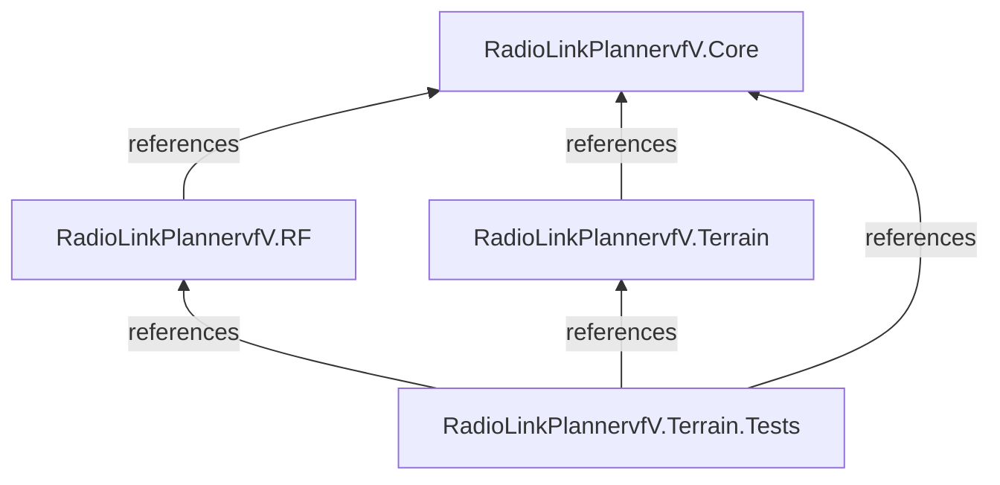

# Architecture — RadioLinkPlanner-Engineering

## 1. Overview

RadioLinkPlanner-Engineering is a selected public release of engineering components from the RadioLinkPlannervfV project.

The repository focuses on three primary areas:

- Domain models and shared contracts
- Radio-frequency calculations
- Terrain processing and analysis

The published code is organized into separate .NET 8 projects with explicit project references.

This repository does not represent the complete architecture of the original application.

## 2. Technology Stack

| Technology | Purpose |
|---|---|
| C# | Primary programming language |
| .NET 8 | Application framework |
| xUnit | Automated testing |
| Microsoft.NET.Test.Sdk | Test execution infrastructure |
| coverlet.collector | Code coverage collection |
| Nullable Reference Types | Compile-time nullability analysis |
| Implicit Usings | Common namespace imports |

All published projects target `net8.0`.

## 3. Repository Structure

The published repository is organized into the following projects:

```text
RadioLinkPlanner-Engineering/
│
├── README.md
├── ARCHITECTURE.md
├── .gitignore
│
├── src/
│   ├── RadioLinkPlannervfV.Core/
│   │   ├── Enums/
│   │   ├── Interfaces/
│   │   ├── Models/
│   │   ├── Services/
│   │   └── ValueObjects/
│   │
│   ├── RadioLinkPlannervfV.RF/
│   │   └── Calculators/
│   │
│   └── RadioLinkPlannervfV.Terrain/
│       ├── Calculators/
│       ├── Exceptions/
│       ├── Generators/
│       ├── Models/
│       ├── Optimizers/
│       ├── Providers/
│       ├── Readers/
│       └── Services/
│
└── tests/
    └── RadioLinkPlannervfV.Terrain.Tests/
```

### Published Source File Count

| Project | C# Files |
|---|---:|
| Core | 49 |
| RF | 2 |
| Terrain | 18 |
| **Total** | **69** |

The count includes C# source files under `src`, excluding test files and other file types.

## 4. Project Responsibilities

### 4.1 RadioLinkPlannervfV.Core

Core contains the shared domain models and abstractions used by the published engineering projects.

Its source structure includes:

| Directory | Responsibility |
|---|---|
| `Enums` | Domain enumeration types |
| `Interfaces` | Contracts for calculations, terrain access, analysis, and persistence |
| `Models` | Domain entities, requests, results, and configuration models |
| `Services` | Shared domain-level services |
| `ValueObjects` | Strongly typed domain values such as distance and frequency |

Examples of published domain concepts include:

- Geographic coordinates
- Sites and radio links
- Radio parameters
- Propagation settings
- Terrain elevation
- Terrain profiles
- Link analysis results
- Link budget models
- Multi-site analysis
- Network analysis
- Project and report contracts

**Dependency rule:**

Core has no project references in its published project file.

This keeps the published domain layer independent of the RF and Terrain implementation projects.

### 4.2 RadioLinkPlannervfV.RF

The RF project contains radio-frequency calculation implementations.

Published source components include:

- `FresnelCalculator`
- `LinkBudgetCalculator`

Its responsibility is to provide RF calculation functionality using the shared contracts and models defined in Core.

**Project dependency:**

```text
RadioLinkPlannervfV.RF
         |
         v
RadioLinkPlannervfV.Core
```

### 4.3 RadioLinkPlannervfV.Terrain

The Terrain project contains terrain-related data processing and analysis components.

Its published source is organized into:

| Directory | Responsibility |
|---|---|
| `Calculators` | Geographic distance and interpolation calculations |
| `Exceptions` | Terrain-related exception types |
| `Generators` | Terrain profile generation |
| `Models` | Terrain configuration and provider options |
| `Optimizers` | Antenna height optimization |
| `Providers` | Offline, online, and fallback elevation providers |
| `Readers` | SRTM file and elevation data reading |
| `Services` | Terrain-related engineering analysis services |

Published implementations include:

- Great-circle interpolation
- Haversine distance calculation
- Terrain profile generation
- SRTM coordinate mapping
- SRTM DEM reading
- SRTM tile metadata handling
- Offline terrain elevation provider
- Open-Meteo terrain elevation provider
- Fallback terrain elevation provider
- Earth curvature calculation
- Link analysis
- Multi-site evaluation
- Antenna height optimization

**Project dependency:**

```text
RadioLinkPlannervfV.Terrain
            |
            v
RadioLinkPlannervfV.Core
```

### 4.4 RadioLinkPlannervfV.Terrain.Tests

The published test project validates selected behavior across the Core, RF, and Terrain projects.

Its project references include:

- RadioLinkPlannervfV.Core
- RadioLinkPlannervfV.RF
- RadioLinkPlannervfV.Terrain

The test project uses xUnit.

Its published tests cover calculation behavior, terrain providers, SRTM data processing, profile generation, multi-site evaluation, and integration or diagnostic scenarios.

## 5. Dependency Architecture

The verified project-reference structure is:



### Project Reference Matrix

| Project | Core | RF | Terrain |
|---|:---:|:---:|:---:|
| Core | — | — | — |
| RF | Yes | — | — |
| Terrain | Yes | — | — |
| Terrain.Tests | Yes | Yes | Yes |

### Dependency Rules

The verified project-reference structure establishes these rules:

1. Core does not reference other published projects.
2. RF references Core.
3. Terrain references Core.
4. Terrain.Tests references Core, RF, and Terrain.
5. No direct RF-to-Terrain project reference is declared in the published project files.

These rules preserve a separation between shared domain abstractions, engineering implementations, and automated tests.

## 6. Architectural Boundaries

The published code separates shared domain contracts from engineering implementations.

### Core Boundary

Core defines shared models, interfaces, and value objects.

It does not contain references to the published RF or Terrain projects.

### Engineering Implementation Boundary

RF and Terrain contain specialized engineering implementations.

Both projects reference Core to use shared domain abstractions.

### Testing Boundary

Terrain.Tests references the published engineering projects to verify selected behavior.

This structure provides separation between domain definitions, engineering implementations, and automated tests.

## 7. Terrain Data Architecture

The published Terrain project includes multiple elevation data access implementations.

### Published Providers

| Component | Purpose |
|---|---|
| `OfflineTerrainProvider` | Offline terrain elevation access |
| `OpenMeteoTerrainElevationProvider` | Online terrain elevation access |
| `FallbackTerrainElevationProvider` | Fallback terrain provider |

### SRTM Processing Components

| Component | Purpose |
|---|---|
| `SrtmDemReader` | SRTM DEM reading |
| `SrtmElevationSampleReader` | Elevation sample reading |
| `SrtmCoordinateMapper` | Coordinate mapping |
| `SrtmFileNameResolver` | SRTM tile filename resolution |
| `SrtmTileMetadata` | Tile metadata |

The repository also includes abstractions for terrain elevation access and batch terrain elevation operations in Core.

The presence of these components does not imply that all required DEM datasets are bundled with the repository.

Actual terrain data availability depends on the runtime environment and configured data sources.

## 8. Build and Test Boundaries

The public repository does not include the complete original solution.

Build and test operations should therefore target the published test project.

Run the following commands from the repository root.

### Restore Dependencies

```powershell
dotnet restore tests/RadioLinkPlannervfV.Terrain.Tests/RadioLinkPlannervfV.Terrain.Tests.csproj
```

### Build

```powershell
dotnet build tests/RadioLinkPlannervfV.Terrain.Tests/RadioLinkPlannervfV.Terrain.Tests.csproj --no-restore
```

### Run Tests

```powershell
dotnet test tests/RadioLinkPlannervfV.Terrain.Tests/RadioLinkPlannervfV.Terrain.Tests.csproj --no-restore
```

A successful restore is required before using `--no-restore`.

These commands validate the published Terrain test project and its referenced engineering projects. They do not validate the complete original application.

## 9. Public Repository Limitations

The following components belong to the broader application but are not included in this public release:

- Infrastructure
- API
- Web application
- Application guide
- Complete application solution
- API.Tests
- Infrastructure.Tests
- Private company and customer datasets
- Full deployment configuration

Consequently, the dependency diagram in this document describes only the published projects.

It should not be interpreted as a complete representation of the original application's architecture.

## 10. Design Considerations

The published project structure demonstrates several architectural principles:

- Separation of shared domain abstractions from specialized implementations
- Explicit project dependencies
- Independent RF and Terrain implementation projects
- Centralized domain contracts
- Automated testing through a dedicated test project
- Use of .NET 8 across the published projects

Future development should preserve these boundaries.

Recommended engineering practices:

- Keep shared domain abstractions in Core.
- Keep RF calculation implementations in RF.
- Keep terrain processing implementations in Terrain.
- Avoid introducing presentation or infrastructure dependencies into Core.
- Validate numerical calculations with appropriate engineering test cases.
- Test missing terrain data and invalid input scenarios.
- Use real elevation datasets for terrain validation.
- Update architecture documentation when verified project references or responsibilities change.

---

**Repository:** [RadioLinkPlanner-Engineering](https://github.com/reyhaanezamzami-gif/RadioLinkPlanner-Engineering)

**Framework:** .NET 8

**Architecture Scope:** Published Engineering Components Only